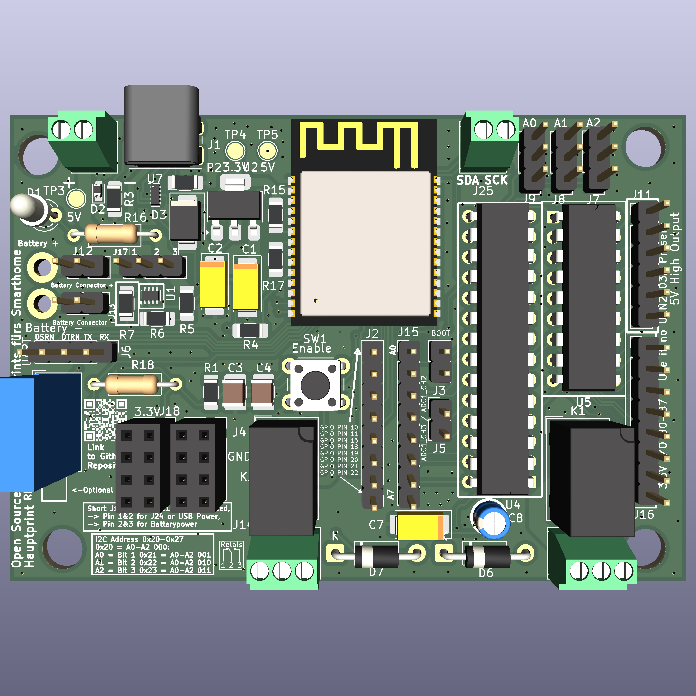
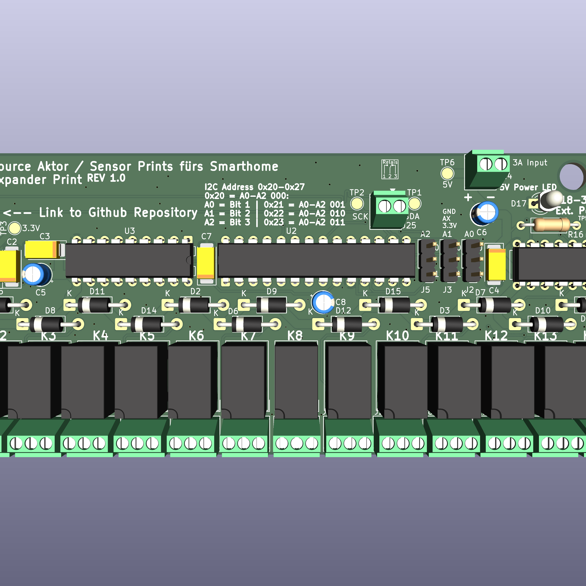

# Diplomarbeit-2026
Offizielle Repository fuer die Diplomarbeit von Steve

There will be an introduction in German before I switch to englisch and explaining the project.

**Idee:**
Die Idee ist es Leiterplatten zu designen, die in einem neuen oder bestehenden SmartHome mit einfachen Schritten integrierbar ist.
Es soll eine einfache aber funktionsreiche Leiterplatte, die z.B. im Fall des Aktor Prints, per I2C an bereits vorhandene Steuerungen verwendet und erweitert werden können.

**Meine Qualifikationen:**
Ich bin gelernter Automatiker und interessiere mich seit meiner Kindheit fuer viele Technik relevante Themen. Schulisch war ich schon immer einer dem die Themen Kunst und Sprachen weniger interessierten im vergleich zu Mathe, Physik und Handarbeit.
Mit 23 hatte ich eine Entscheidung getroffen, mich Schulisch weiterzubilden. Dies ist bis jetzt immer noch eine Entscheidung die ich nicht bereue. Der Weg zu dieser Diplomarbeit war steinig und hart, hatt aber viel spass gemacht.
Eine Leiterplatte hatte ich einmalig in der Lehre mit meinem damaligen Lehrlingsbetreuer gezeichnet, dies aber danach nie mehr wiederholt. Das Programm damals hie Eagle.

**Die Ausführung:**
Zu diesem Repo existiert noch meine Arbeit die ich paralell dazu Schreibe. Die Idee des Repo ist es die notwendigen Daten: KiCad, Gerber Files, Gehause oder Programmzeilen fuer spaetere vorhaben zu Speichern und der breiten masse zur Verfügung zu stellen. Sämtliche Erarbeiteten Schema oder CAD Files sind hier zu finden.
Die Arbeit werde ich nicht auf das Repo hochladen.

**Haftungsausschluss:**
Ich bin weder fuer die korrekte Anwendung noch meine Fehler verantwortlich, saemtliche Schaeden die durch alle Dateien auf diesem Repo verursacht wurden, sind alleinig dem Anwender zuzuschreiben.
Die Leiterplatten sind von keinem Pruefunternehmen abgenommen oder auf ihre Sicherheit geprueft worden. Bei Verwendung sind alle Regeln der Technik zu beachten.

#######################################################################################

Official repository for Steve's diploma thesis.

**Idea**
The concept is to design printed circuit boards (PCB's) that can be easily integrated into a new or existing SmartHome system.
The goal is to create simple yet feature-rich PCB's such as the actuator board that can connect to existing control systems via I2C or UART.

**My Qualifications**
I am a trained automation technician and have been interested in many tech-related topics since childhood. At school, I was always less interested in art and languages compared to math, physics, and practical crafts. At 23, I made the decision to further my education—a choice I still do not regret today. The path to this diploma thesis was rocky and hard, but it was also a lot of fun. I designed a printed circuit board (PCB) once during my apprenticeship with my mentor at the time, but never repeated the process after that. The software back then was called EAGLE.

**Workflow**
In addition to this repository, I am writing my thesis in parallel. The purpose of this repo is to store the necessary project files—such as KiCad files, Gerber files, enclosure models, or code lines for future reference.
I will not be uploading the written thesis itself to this repository. During the Duration of the thesis, the repo will receive steady updates/minor or major changes depending on how well the PCB's perform.

**Disclaimer**
I am not responsible for the correct application of these files, nor for any errors within them. Any damages caused by files in this repository are solely the responsibility of the user.
The PCB's have not been certified or safety-tested by any official inspection body. When using them, all applicable engineering standards and safety codes must be strictly followed.
I'm still learning so expect some major flaws along the way.

**What to expect:**
You will be able to order the following PCB from your favorite PCB Manufacturer, the files and a basic Enclosure designed in FreeCAD is included in the Folders.
Everything provided is free and Open Source so you won't have to pay a dime for some program.

**Hauptprint aka the Brain**
It's purpose is being able to be integrated into your existing SmartHome while offering a wide range off pre-configured In/Outputs.
There are optional Components which you wont have to solder onto for it to work.
The ESP32 C6 Wroom1 supports Thread/Zigbee, Wi-Fi 6 (2.4gHz only!), Bluetooth 5.0, UART, I2C and I2S, which should be plenty for your needs.

**The RelaisExpanderPrint aka the Switchmaster**
The RelaisExpanderPrint was designed with compatibility and versatility in mind. The Idea was to create a 16x Relays Switching device with Potential-free contacts in mind, as you would find on a PLC or in an Switching Cabinet.
Its size is as compact as i was able to design it with an Power-supply input that support different Voltage Levels depending on your needs.
The TracoPower Component (PS1) is interchangeable in its product line so you can choose Supply Voltages ranging from 9V,12V,24V or up to 75V DC. 

**Programming**
The Project is designed to be used with ESP-Home.
Configuration is up to you, the basis is an ESP32 C6 Wroom1 with I2C lines pre-routed and battery connectors pre-installed with a Powermux for dual Power Supply input simultaneously.

There is an Example Code in the RelaisExpander PCB Folder for all Relay. Which helps you to understand how to use it in your Project.

**Your Contribution**
If you may want to offer some advice or if you like the project i would appreciate it very much. Some may end up in my thesis.

**IMPORTANT INFORMATION**
This Repo will be Closed on the 28th of October, there will be no new Update on here. I might Fork it on my non School Github Page if anyone is interested.
